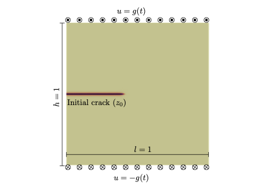
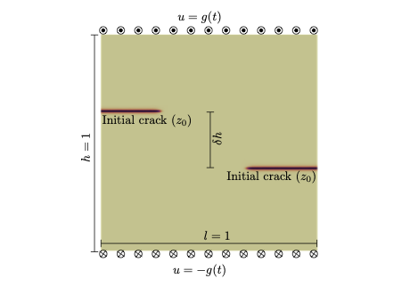
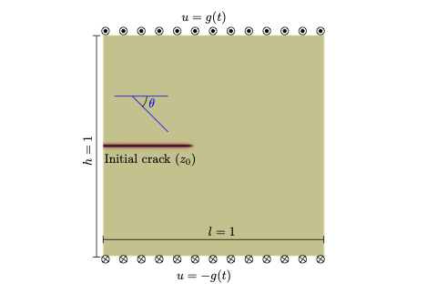
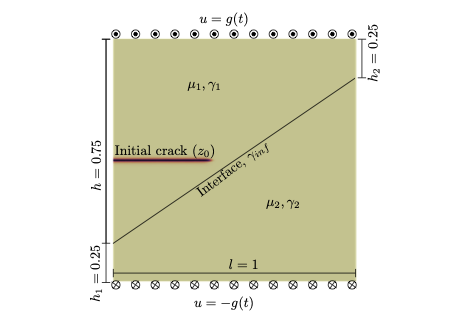

# Parallel-Computing-for-a-Phase-Field-Model-of-Antiplane-Fracture-Using-FreeFEM


## Governing Equations

The governing equations of the antiplane phase-field fracture model are given by

```math
\begin{cases}
\rho \dfrac{\partial^2 u}{\partial t^2}
= \nabla \cdot \left((1-z)^2\mu\nabla u\right)
& \text{in } \Omega, \\[8pt]
\alpha \dfrac{\partial z}{\partial t}
=
\left(
\epsilon\nabla \cdot (\gamma\nabla z)
-\dfrac{\gamma}{\epsilon}z
+\mu|\nabla u|^2(1-z)
\right)_+
& \text{in } \Omega.
\end{cases}
```

## Domain Setting 

The computational domain and boundary conditions used in the numerical simulations are illustrated below.

## Domain Setting

<table>
  <tr>
    <td align="center">
      
      <br>
      <b>(a) Single-notch material</b>
    </td>
    <td align="center">
      
      <br>
      <b>(b) Double-notch material</b>
    </td>
    <td align="center">
      
      <br>
      <b>(c) Anisotropic material</b>
    </td>
    <td align="center">
      
      <br>
      <b>(d) Interface material</b>
    </td>
  </tr>
</table>

